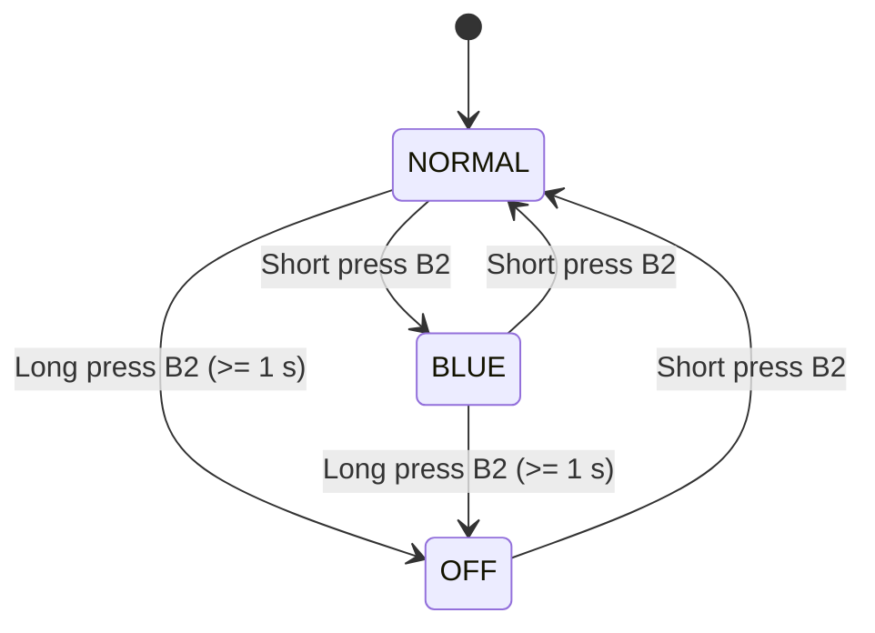

# Hands On Lab — Ambient Light Monitoring System

## 1. Project Overview

This project implements an ambient light monitoring system using **Zephyr RTOS**. The system reads light intensity through an ADC and controls an RGB LED according to the measured brightness.

The application uses multiple threads and synchronization mechanisms to manage the sensor, LED, and user input. The operating mode can be changed using button B2.

## 2. Functional Requirements

### 2.1. Basic Requirements

The basic system implements two operating modes: **NORMAL** and **BLUE**.

- **NORMAL mode:**
  - Measure ambient light intensity using the ADC every 2 seconds.
  - Calculate brightness as a percentage of the ADC full-scale range.
  - Set the RGB LED color according to the measured brightness:
    - RED: brightness below 33%.
    - YELLOW: brightness between 33% and 66%, inclusive.
    - GREEN: brightness above 66%.
  - Print the current mode and ADC readings to the serial terminal.

- **BLUE mode:**
  - Keep the RGB LED blue.
  - Suspend ADC measurements until NORMAL mode is restored.

- **Button B2:**
  - A short press switches between NORMAL and BLUE modes.

### 2.2. Extra Requirements

The extra functionality introduces a third operating mode: **OFF**.

- A long press of button B2 (at least 1 second) activates OFF mode from NORMAL or BLUE.
- In OFF mode, the RGB LED is turned off and ADC measurements are suspended.
- The serial terminal prints `System OFF`.
- A short press of button B2 while in OFF mode restores NORMAL mode.
- The long-press event must be detected as soon as the 1-second threshold is reached, without waiting for button release.
- Releasing the button after a long press must not trigger an additional short-press event.

## 3. State Machine Diagrams

### 3.1. Basic State Machine

The basic state machine contains two states: NORMAL and BLUE.


<br>
<br>
<br>
<br>

**State behavior:**

- **NORMAL:** The ADC measures brightness every 2 seconds, and the RGB LED indicates the brightness level.
- **BLUE:** The RGB LED remains blue, and ADC measurements are suspended.

### 3.2. Extended State Machine (Extra)

The extended state machine adds the OFF state and long-press detection.



**State behavior:**

- **NORMAL:** Periodic ADC measurements are enabled, and the RGB LED reflects the brightness level.
- **BLUE:** The RGB LED remains blue, and ADC measurements are suspended.
- **OFF:** The RGB LED is off, ADC measurements are suspended, and `System OFF` is printed to the serial terminal.

The long-press event must be generated when the button has been held for at least 1 second. The subsequent button release must not be interpreted as a short press.

## 4. Software Architecture

The application is organized into separate source files to improve modularity and maintainability.

The proposed responsibilities are:

- **`main.c`** — Application initialization and startup.
- **`button.c`** — Button B2 handling, including short-press and long-press detection.
- **`adc.c`** — ADC initialization, periodic sampling, and brightness calculation.
- **`rgb.c`** — RGB LED initialization and color control.
- **`mode_manager.c`** — Operating-mode management and state transitions.

Additional threads are implemented in separate source files, as required by the project specification.

The final thread organization and communication mechanisms will be documented according to the implemented design.

## 5. Hardware Requirements

The project is implemented on an STM32WL Nucleo-64 board running Zephyr RTOS.

### Pin Connections

The following table describes the hardware connections used by the application.

| Component | Signal | Board Pin | Description |
|---|---|---|---|
| RGB LED | Red | PB5 | Controls red channel |
| RGB LED | Green | PC1 | Controls green channel |
| RGB LED | Blue | PC2 | Controls blue channel |
| KY-018 LDR  | ADC | PB1 | Analog imput / Measures light intensity |

## 5. Implementation Status and Code Description

This section describes the implemented software modules, explains how they work, and tracks the development progress of the application.

### 5.1. RGB LED Control Module (`rgb.c` / `rgb.h`)

**Status: Implemented as a standalone module. Integration with the complete application is pending.**

The RGB LED control module manages the RGB LED using three GPIO outputs, one for each color channel: red, green, and blue. It runs in a dedicated Zephyr thread and receives LED commands through a message queue.

This module was originally developed by me for a previous project involving a humidity sensor and has been reused for the current application.

#### Thread Architecture

The module defines a dedicated thread using `K_THREAD_DEFINE()`. The thread executes the `my_thread_rgb()` function and is responsible for initializing the LED GPIOs, receiving messages, and updating the LED output.

The thread uses a message queue to receive commands from other software modules. This separates LED control from the application logic and allows other threads to request a color change without directly manipulating the GPIO pins.

#### Message Queue

The message queue is named `rgb_q` and is defined in `rgb.c`. It has a capacity of one message, so it can hold one pending LED command.

The queue transfers messages using the following structure, defined in `rgb.h`:

```c
struct rgb_mode {
    uint32_t mode;
    int32_t period_ms;
};
```

The structure contains two fields:

- **`mode`**: Specifies the requested LED color using one of the predefined color constants.
- **`period_ms`**: Specifies the time interval in milliseconds used by the thread when waiting for a new message. When no new message arrives during this interval and the period is positive, the selected LED channels are toggled to produce blinking behavior.

The queue is declared in the header file using:

```c
extern struct k_msgq rgb_q;
```

This declaration allows other source files to access the queue and send LED commands using Zephyr's message queue API, such as `k_msgq_put()`.

#### Supported Colors

The header file defines six color modes:

| Constant | LED Output |
|---|---|
| `BLUE_LED` | Blue |
| `RED_LED` | Red |
| `GREEN_LED` | Green |
| `YELLOW_LED` | Red + Green |
| `PURPLE_LED` | Red + Blue |
| `CIAN_LED` | Green + Blue |

The requested color is selected using the `mode` field of the received message. The `set_color()` function first turns off all three LED channels and then activates the GPIO outputs corresponding to the requested color.

The `toggle_color()` function toggles the channels associated with the selected color, allowing the LED to blink when the configured period is positive and no new message arrives before the timeout.

#### GPIO Initialization

The module obtains the GPIO specifications for the RGB channels through the Zephyr devicetree aliases `rgbblue`, `rgbred`, and `rgbgreen`.

Before using each channel, `initialize_RGB()` checks that the GPIO device is ready and configures the pin as an output. This ensures that the LED channels are initialized before the thread starts processing commands.

#### Communication with Other Modules

Other threads can request an LED behavior by sending a `struct rgb_mode` message to `rgb_q`. 

### 5.2. Light Control Module (`adc.c` / `adc.h`)

**Status: Implemented as a standalone module. Integration with the complete application is pending.**

Initializes ADC, read raw data from LDR and converts it into percentage. 

0% -> Dark
100 % -> Bright

The message queue extracts the raw and percentage values ​​for processing.

### 5.3. B2 Button Control Module (`button.c` / `button.h`)

**Status: Not implemented**

### 5.4. Mode Manager (`mode_manager.c` / `mode_manager.h`)

**Status: Not implemented**

