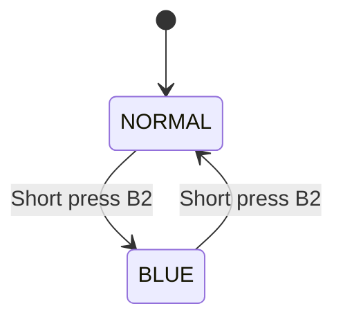
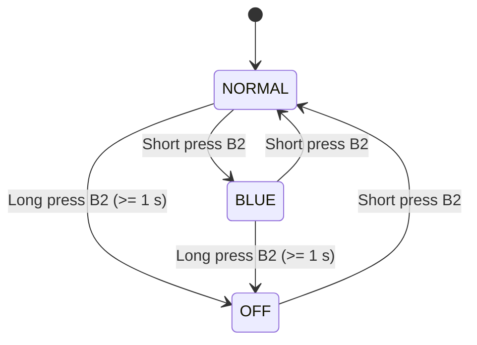

# Hands On Lab — Ambient Light Monitoring System

## 1. Project Overview

This project implements an ambient light monitoring system using **Zephyr RTOS**. The system reads light intensity through an ADC and controls an RGB LED according to the measured brightness.

The application uses multiple threads and synchronization mechanisms to manage the sensor, LED, and user input. The operating mode can be changed using button B2.

## 2. Functional Requirements

### 2.1. Basic Requirements

The basic system implements two operating modes: **NORMAL** and **BLUE**.

- **NORMAL mode:**
  - Measure ambient light intensity using the ADC every 2 seconds.
  - Calculate brightness as a percentage of the ADC full-scale range.
  - Set the RGB LED color according to the measured brightness:
    - RED: brightness below 33%.
    - YELLOW: brightness between 33% and 66%, inclusive.
    - GREEN: brightness above 66%.
  - Print the current mode and ADC readings to the serial terminal.

- **BLUE mode:**
  - Keep the RGB LED blue.
  - Suspend ADC measurements until NORMAL mode is restored.

- **Button B2:**
  - A short press switches between NORMAL and BLUE modes.

### 2.2. Extra Requirements

The extra functionality introduces a third operating mode: **OFF**.

- A long press of button B2 (at least 1 second) activates OFF mode from NORMAL or BLUE.
- In OFF mode, the RGB LED is turned off and ADC measurements are suspended.
- The serial terminal prints `System OFF`.
- A short press of button B2 while in OFF mode restores NORMAL mode.
- The long-press event must be detected as soon as the 1-second threshold is reached, without waiting for button release.
- Releasing the button after a long press must not trigger an additional short-press event.

## 3. State Machine Diagrams

### 3.1. Basic State Machine

The basic state machine contains two states: NORMAL and BLUE.

**State behavior:**

- **NORMAL:** The ADC measures brightness every 2 seconds, and the RGB LED indicates the brightness level.
- **BLUE:** The RGB LED remains blue, and ADC measurements are suspended.

### 3.2. Extended State Machine (Extra)

The extended state machine adds the OFF state and long-press detection.

**State behavior:**

- **NORMAL:** Periodic ADC measurements are enabled, and the RGB LED reflects the brightness level.
- **BLUE:** The RGB LED remains blue, and ADC measurements are suspended.
- **OFF:** The RGB LED is off, ADC measurements are suspended, and `System OFF` is printed to the serial terminal.

The long-press event must be generated when the button has been held for at least 1 second. The subsequent button release must not be interpreted as a short press.

## 4. Software Architecture

The application is organized into separate source files to improve modularity and maintainability.

The proposed responsibilities are:

- **`main.c`** — Application initialization and startup.
- **`button.c`** — Button B2 handling, including short-press and long-press detection.
- **`adc.c`** — ADC initialization, periodic sampling, and brightness calculation.
- **`rgb.c`** — RGB LED initialization and color control.
- **`mode_manager.c`** — Operating-mode management and state transitions.

Additional threads are implemented in separate source files, as required by the project specification.

The final thread organization and communication mechanisms will be documented according to the implemented design.

## 5. Hardware Requirements

The project is implemented on an STM32WL Nucleo-64 board running Zephyr RTOS.

### Pin Connections

The following table describes the hardware connections used by the application.

| Component | Signal | Board Pin | Description |
|---|---|---|---|
| RGB LED | Red | PB5 | Controls red channel |
| RGB LED | Green | PC1 | Controls green channel |
| RGB LED | Blue | PC2 | Controls blue channel |

